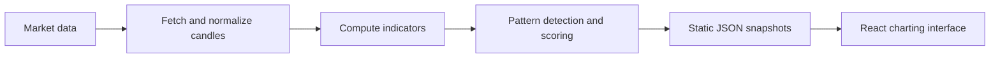

# DailyNumbers

A technical pattern scanner that turns S&P 500 market data into ranked setups and an interactive charting interface. A Python batch pipeline analyzes daily and weekly candles, scores supported patterns and publishes JSON consumed by a React frontend.

**Status:** end-of-day scanning and research visualization. DailyNumbers does not place broker orders.

## What it does

- Fetches OHLCV data for the S&P 500 universe on daily and weekly timeframes.
- Computes trend, momentum, volume and volatility indicators.
- Detects supported candlestick and chart patterns, including specialized setups such as double tops/bottoms, EMA knots and triangle breakouts.
- Scores setups using pattern rules and confirmation signals, with higher-timeframe checks where applicable.
- Displays ranked setups, chart annotations and calculated entry, stop-loss and take-profit levels.

## System overview



The frontend reads generated snapshots rather than querying a live trading backend. It can display the committed dataset without running a new scan.

## Preview the interface

The frontend declares **Node.js 24.x** in its package configuration.

```bash
git clone https://github.com/arushg05/Daily.git
cd Daily/frontend
npm install
npm run dev
```

Open the address printed by Vite. The UI loads [setups.json](frontend/public/data/setups.json) and the committed candle snapshots in [frontend/public/data](frontend/public/data). Check the snapshot metadata for freshness; previewing the UI does not refresh market data.

## Start here

| Component | Responsibility |
|---|---|
| [backend/main.py](backend/main.py) | Batch scan orchestration and JSON generation |
| [backend/data_fetcher.py](backend/data_fetcher.py) | Universe and market-data fetching |
| [backend/indicators.py](backend/indicators.py) | Technical indicator calculations |
| [backend/pattern_matcher.py](backend/pattern_matcher.py) | Pattern detection, scoring and setup selection |
| [backend/pattern_math.py](backend/pattern_math.py) | Additional pattern calculations |
| [backend/config.py](backend/config.py) | Timeframes, universe settings and scoring parameters |
| [frontend/src](frontend/src) | Setup list, detail view and interactive charts |
| [.github/workflows/daily_scan.yml](.github/workflows/daily_scan.yml) | Scheduled scan workflow |

## Generate a fresh scan

The Python workflow targets Python 3.12. From the repository root:

```bash
python -m pip install -r backend/requirements.txt
```

The indicator module also imports **`pandas_ta`**, which is not currently declared in that requirements file. A compatible installation is required before running the scanner; installing the listed requirements alone is not a complete scanner setup.

With that dependency available:

```bash
python backend/main.py
```

This writes setup and candle snapshots under `frontend/public/data/`. The scan configuration is in [backend/config.py](backend/config.py). The repository includes a weekday scheduled workflow; its presence does not guarantee a successful or current dataset.

## Scope

Scores are rule-based rankings, not calibrated probabilities or demonstrated win rates. The scanner covers its implemented pattern set; it does not claim to recognize every chart pattern. Entry, stop-loss and take-profit levels are research outputs rather than submitted orders.

**Stack:** Python, Pandas, NumPy, SciPy, pandas_ta, React, TypeScript, Vite, TradingView Lightweight Charts.
